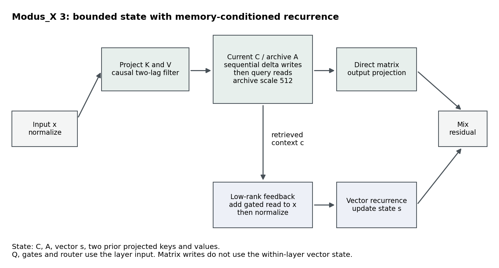

# Modus_X 3 Architecture

Each of 12 layers maintains a current matrix C, archive matrix A and vector
state s. Projected K and V pass through zero-initialized two-lag causal
depthwise filters, then key normalization and value tanh. Queries are not
filtered. Delta writes update both matrices; their mixed, gated read is
compressed through a rank-32 bridge and added to the vector input before the
selective recurrence updates. A scalar router combines direct matrix and vector
outputs, followed by a residual addition.

The archive retention is sigmoid(logit + log(512)). This changes its operating
point; a learned bias can absorb the offset, so it does not enlarge the function
class. Both tested K/V arms use this same calibration.

Two-stage chunk32 execution batches projections around two sequential scans.
It exploits within-layer matrix independence from the vector state, not
independence from preceding layers. Canonical execution remains a verification
reference. This is not an official-Mamba recurrence or an attention layer.

At width512/depth12 the K/V candidate has47,462,344 training parameters and
25,288,704FP32 persistent-state bytes per sequence. This includes96KiB of added
K/V history. State does not grow with sequence length; width, activations,
optimizer storage and per-token computation remain separate costs.

The full equations, ordering of decay/residual writes and execution argument
are in [the paper source](../paper/manuscript/main.tex). Frozen implementation:
`research/v3/05_local_kv_filtering/src/local_kv.py`, `two_stage.py`, `models.py`.

Earlier CurrentArchiveDelta synthetic-memory results are historical companion
evidence, not a test of semantic updates by the trained v3 language checkpoint.
